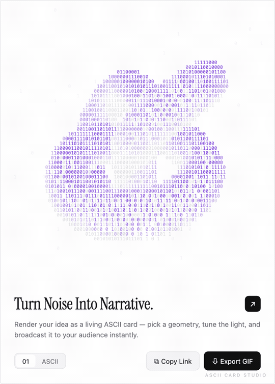

<div align="center">

# ASCII Card Studio

**Turn your name, slogan, or logo into a living 3D ASCII card.**

把你的名字、slogan 或 logo，变成一张会转的 3D ASCII 字符卡片。

[](https://ascii-card-studio.pages.dev/)



</div>

---

灵感来自 X 上一段[动态 ASCII 卡片视频](https://x.com/praveenisomer/status/2092222962153697540)（@praveenisomer）：一个用 0 和 1 画出来的 3D 环面结在卡片里不停翻滚。于是把这个效果做成了一个**生成器**——任何人都能把自己的内容放进去，导出成 GIF / 视频 / 静态图分享出去。

**在线使用（推荐）**：[https://ascii-card-studio.pages.dev](https://ascii-card-studio.pages.dev/)
单文件、零构建、纯本地运行——不上传任何内容，关掉网页数据就没了。

## 三种自定义模式

| 模式 | 说明 |
|------|------|
| **几何体** | 环面结（视频同款）/ 圆环 / 球体 / 莫比乌斯环，donut.c 式字符 3D 旋转 |
| **文字** | 输入你的名字或 slogan，文字铺满几何体表面一起旋转（文字环球） |
| **图片** | 上传或直接拖拽 logo / 头像到卡片，实时 ASCII 化（自动对比度拉伸） |

## 其他可玩的东西

- **字符集**：`01` 二进制 / ASCII 灰度渐变 / ✎ 任意自定义字符（比如用 `TUSHAO·` 画整个模型）
- **6 种配色**：紫罗兰 / 墨色 / 矩阵绿 / 琥珀 / 青 / 品红
- **速度 / 密度**滑杆，**拖动**动画区域手动旋转
- **点击即改**：卡片标题、描述直接在卡上编辑（衬线排版 + 裁切角标，还原原视频质感）
- **Copy Link**：全部配置编码进 URL，分享出去对方打开即还原你的卡片
- **导出**：整卡 GIF（3 秒）/ PNG 高清静态图 / WebM 视频（4 秒），自带卡片排版和水印

## 用它来做什么

- 给自己 / 产品做一张会动的名片，发 X、小红书、微信状态
- README 里放一个自定义字符集的旋转 logo
- 直播 / 演示的开场画面

## 原理

经典 donut.c 渲染管线的浏览器版：

```
参数曲面采样 → 旋转矩阵 → 透视投影 → z-buffer → 兰伯特光照 → 字符格上色（canvas 批量绘制）
```

- 文字模式：把文本按 `(u, v)` 参数空间贴到曲面上，字符随表面一起旋转
- 图片模式：亮度网格采样 + min-max 对比度拉伸
- 整卡导出：`html2canvas` 拍静态排版 + ASCII canvas 逐帧合成 → `gif.js` 编码（两个库均为 CDN 懒加载）

## 本地运行

```bash
git clone https://github.com/tt-a1i/ascii-card-studio.git
open ascii-card-studio/index.html   # 就这一个文件，浏览器打开即用
```

## 部署（Cloudflare Pages）

线上版本托管在 Cloudflare Pages。自己部署一份：

```bash
npx wrangler login
npx wrangler pages project create your-name --production-branch=main
npx wrangler pages deploy . --project-name=your-name
```

## Credits

- 灵感：[@praveenisomer](https://x.com/praveenisomer) 的动态 ASCII 卡片
- 致敬：[donut.c](https://www.a1k0n.net/2011/07/20/donut-math.html) — Andy Sloane

---

<div align="center">
<sub>MIT License · built with ASCII</sub>
</div>
